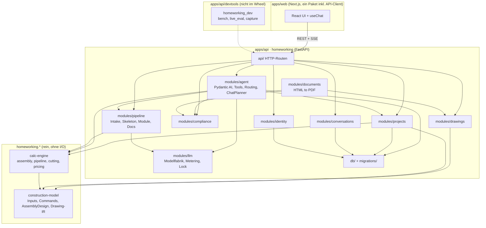

# Struktur und Umsetzungsstand

- Stand: 2026-10-29 (gemessen am Code)
- Zweck: Überblick, welche Pakete es gibt, wer wen importiert und was sich als Nächstes
  refaktorieren lässt.
- Fachliche Regeln: [ARCHITEKTUR.md](ARCHITEKTUR.md), Engine: [ENGINE.md](ENGINE.md).

## 1. Stack

**Ein Stack, ein Python-Paket, ein Web-Paket.** Am 2026-10-29 wurden die Go-Portierung (`backend/`, ADR-0009) und die
Vite-SPA (`frontend/`) entfernt. Zuvor existierten zwei halbfertige Parallelstacks. Es gilt:

| Schicht | Technik |
|---|---|
| Backend | Python 3.13, FastAPI, SQLAlchemy (async) + Alembic, Pydantic AI |
| Domäne und Engine | `homeworking.construction_model`, `homeworking.calc_engine` (Unterpakete von `apps/api`, rein, ohne I/O) |
| Frontend | `apps/web`: Next.js 16, React 19, Vercel AI SDK `useChat`, TanStack Query, three.js, Tailwind 4 |
| API-Vertrag | aus FastAPI exportiert (`task openapi`) nach `apps/web/openapi.json`, TS-Client in `apps/web/src/api` mit `@hey-api/openapi-ts` |
| Datenbank | PostgreSQL (Produktion), SQLite (Tests) |
| PDF | WeasyPrint aus HTML-Vorlage |
| Tests | pytest inkl. pytest-bdd (`apps/api/tests`) · Vitest (`apps/web/src/lib`) · Playwright und playwright-bdd (`apps/web/tests/{e2e,bdd}`) |

ADR-0009 (Go-Neuanfang) wurde nicht umgesetzt; ein Ersatz-ADR steht aus. ADR-0010
(Entwurfspipeline) bleibt gültig, ihr Hinweis auf eine Go-Portierung ist gegenstandslos.

## 2. Paketkarte

Zeilen (ohne Tests): `modules` 4,9k, `calc_engine` 6,2k, `construction_model` 1,2k, `api` 0,9k, `devtools` 2,1k.

Saubere Grenzen (`lint-imports`, sieben Verträge in `pyproject.toml`): `construction_model` und
`calc_engine` kennen weder FastAPI noch SQLAlchemy noch Pydantic AI; nur `api/` darf
`modules.agent` und `modules.pipeline` nutzen; `pipeline` importiert nicht `agent`, `llm` keines von
beiden, `modules/*` weder `api` noch `bootstrap`, und die Laufzeit nicht `homeworking_dev`.

## 3. Auffälligkeiten

Stand der Prüfung am 2026-10-29 (ruff, mypy strict, import-linter, eslint, tsc grün).

### Backend (`apps/api`)

- **Große Dateien:** `calc_engine/assembly/derive.py` (1,2k), `intent.py` (0,9k) und
  `devtools/homeworking_dev/live_eval.py` (0,9k). Rund 216 × `Any` außerhalb der Engine.
- **ADR offen:** Ein Ersatz-ADR für ADR-0009 fehlt (siehe §4).

Erledigt am 2026-10-29: Fehlerpfade der Pipeline-Endpunkte und des Chats landen in `agent_runs`
(422 mit deutscher Meldung); `pipeline` ist von `agent` gelöst (`modules/llm`, `ChatPlanner` nach
`modules/agent/planner.py`, vier neue Importverträge); Werkzeug-Code liegt in
`apps/api/devtools/homeworking_dev`; Provenienz-Lock, Threadpool-Helfer (`homeworking.concurrency`)
und `save_design_creates` (Einstellung `AGENT_SAVE_DESIGN_CREATES`) sind vereinheitlicht;
`agent/tools.py` ist in `deps`, `design_tools`, `project_tools`, `capabilities` und `summaries`
geteilt; `ENVIRONMENT` ist standardmäßig `production` (Entwicklungs-Secret wird sonst abgelehnt);
„golden“ heißt im Fallformat `reference`.

### Frontend (`apps/web`)

Keine offenen Auffälligkeiten (eslint, tsc und Vitest grün; Browser-Tests grün). Die am 2026-10-29
gefundenen Punkte sind behoben, siehe §4.

## 4. Refaktorier-Kandidaten

Erledigt am 2026-10-29: ein Python-Paket (`construction_model` und `calc_engine` als Unterpakete von
`homeworking`, ein Importvertrag), ein Web-Paket (API-Client in `src/api`, `tests/e2e` und
`tests/bdd` mit einer Playwright-Konfiguration, gemeinsame Testhelfer), Backend-BDD in Python
(pytest-bdd), `bdd` und `e2e` laufen in der CI.

Erledigt am 2026-10-29 im Frontend: doppelte Browser-Tests entfernt (`tests/bdd` bleibt, `tests/e2e`
nur noch für Abläufe ohne Szenario), Vitest für `src/lib` (läuft in `task check:web` und CI),
`ProjectPanel` und `ProjectDetails` in `ProjectPanel/`, `ParamEditor` und `BuildSteps` aufgeteilt,
gemeinsame Hooks (`useGlobalKey`, `useStoredSet`), ein Helfer für Query-Invalidierung
(`lib/api.ts`), `key` auf der Projektseite, Fehlerpfade beim Chatverlauf und im Brief,
Live-Region im Chat, toter Code entfernt, `intake.ts`-Wartebedingung.

Offen, sortiert nach Hebel gegenüber Aufwand:

1. **ADR schreiben**, das ADR-0009 ablöst (Python und Next.js bleiben), und ADR-0010 bereinigen.
2. **Große Dateien** `derive.py`, `intent.py`, `live_eval.py` nur bei Anlass teilen; `Any` im
   Backend schrittweise durch Modelle ersetzen.

Erledigt am 2026-10-29 im Backend: Fehlerpfade in `agent_runs`, `pipeline` von `agent` gelöst
(`modules/llm`, Importverträge), Werkzeug-Code nach `apps/api/devtools`, `tools.py` und Provenienz
entflochten, `save_design_creates` als Einstellung, Secret-Prüfung (`ENVIRONMENT` ist standardmäßig
`production`), „golden“ nach `reference` umbenannt. Details: §3.
